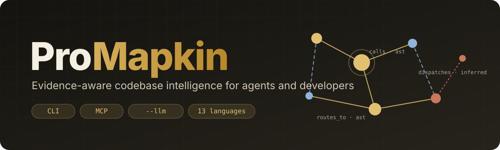

<p align="center">
  
</p>

<p align="center">
  <b>A persistent, evidence-aware model of your codebase.</b><br>
  Blueprints, a semantic code graph, task context and agent handoffs, over CLI, MCP and optional LLMs.
</p>

---

Promapkin turns a repository and its documentation into an evidence-backed architectural blueprint, a
queryable code graph, and reusable task context. Coding agents share all of it through **MCP**. Developers use
the same engine from the **CLI**, and can add `--llm` to any command to bring Anthropic or OpenAI models into the
analysis.

It rests on one idea: a coding agent should not have to rediscover a project's architecture every time it starts
a task or picks up another agent's work.

- **Evidence everywhere.** Every node and edge records how it was obtained, along with its revision, source
  location and freshness. Evidence kinds include `ast`, `static_resolved`, `lexical`, `manifest`,
  `documentation`, `runtime`, `heuristic`, `ml_classifier`, `llm_extraction`, `llm_inference`, `name_match`,
  `agent_inference` and `handoff`. Traversal and retrieval rank results by that trust.
- **Real parsers first, 50 languages.**
  - Python uses the AST.
  - JS/TS uses the TypeScript compiler, including type-checked call resolution. Vue and Svelte components go
    through the same path.
  - 46 more languages use tree-sitter, from Go, Rust, Java and C# to Elixir, Haskell, Zig, Solidity and Verilog.
  - Every language has a lexical fallback, so nothing is invisible.
- **Beyond application code.**
  - Infrastructure: Dockerfiles, Compose, Kubernetes, Terraform, CI and OpenAPI.
  - Schemas: SQL, Prisma, GraphQL and protobuf.
  - Assets: PDFs, Word and PowerPoint files, images and video.
  - All of it is linked to the code it runs, configures, stores or describes.
- **Static + dynamic.**
  - Reflection, dynamic imports, callbacks, DI, fixtures and event wiring are detected statically.
  - Opt-in runtime tracing (`trace run -- pytest`) adds the call edges only execution shows.
- **One command per assistant.** `promapkin install --platform claude-code` (or Cursor, Copilot, Codex, Gemini, and
  14 more) registers the MCP server and adds instructions, hooks and commands. Every change is merge-safe and
  reversible.
- **Local by default.** SQLite, zero required dependencies, no repository code executed by scanning. Models,
  parsers and LLMs are opt-in.

## Quick start

```bash
pip install -e .                          # core: zero dependencies
pip install -e '.[all]'                   # + LLM SDKs, tree-sitter, embeddings, numpy, pypdf, PyYAML
promapkin parsers install                 # optional: TypeScript compiler + tree-sitter grammars
cd /path/to/repo
promapkin init && promapkin scan          # incremental, transactional
promapkin install --platform claude-code  # or --detected: MCP server, instructions, hooks, commands
promapkin blueprint generate --goal "add rate limiting to the API"
promapkin graph html                      # interactive, offline graph explorer
promapkin doctor                          # what is enabled, what is missing
```

Measured on real repositories with hand-written developer questions (built-in ML tier, single core;
[docs/BENCHMARK.md](docs/BENCHMARK.md)):

| Repository | Files | Scan | Package contains a right file | recall@10 | Package tokens | Grep-and-read tokens |
|---|---|---|---|---|---|---|
| fastapi/fastapi (Python) | 3,155 | 44 s | 68% | 0.68 | 1.8k | 438k (242×) |
| clap-rs/clap (Rust) | 482 | 8 s | 71% | 0.64 | 2.0k | 306k (157×) |
| Promapkin (Python) | 114 | 3 s | 90% | 0.85 | 1.9k | 73k (37×) |

Grep-and-read is a simple baseline (open files ranked by matching words until the right ones are read), so the
ratio is an upper bound on what an agent saves. Read it together with the hit rate. Rescans only re-extract
changed files and re-resolve the references those changes can affect.

## What you get

`promapkin blueprint generate` writes `.promapkin/blueprints/`:

| File | Contents |
|---|---|
| `00-reconnaissance.md` | languages, entry points, conventions, missing context, security notices |
| `01-architecture.md` | subsystems, layers, dependencies, layer violations, integrations, style, semantic components, infrastructure, data model |
| `02-dataflow.md` | entry point → sink flows (DB, HTTP, files, queues, config), static vs inferred steps |
| `03-api-atlas.md` | endpoints, handlers, params, auth boundaries, public interfaces, packages, hotspots |
| `04-patterns.md` | Strategy, Adapter, Repository, DI, Factory… with roles, confidence and classifier agreement |
| `05-decisions.md` | ADRs, rationale stated in code, inferred decisions (rationale "unknown" unless documented) |
| `06-risks.md` | risky symbols (fan-in, complexity, untested, writes, churn), structural risks, TODOs |
| `07-verification.md` | documentation claims checked against code; contradictions; stale knowledge |
| `08-roadmap.md` | dependency-ordered plan with prerequisites, tests, migrations, risks |
| `diagrams/*.mmd`, `blueprint.json`, `AGENT_GUIDE.md`, `graph.html` | Mermaid sources (including `infrastructure.mmd` and the `er.mmd` entity diagram), machine-readable blueprint, agent orientation, graph explorer |

Each claim is tagged, for example `` `[observed · ast · 1.00]` (searchapp/api/routes.py:21) ``.

## CLI

```bash
promapkin scan | sync | verify | status | doctor
promapkin blueprint generate [--goal "..."] | architecture | dataflow | api | patterns | decisions | risks | roadmap "goal"

promapkin graph query "Command"                       # hybrid search: exact symbols, BM25, embeddings, graph
promapkin graph impact "APIRouter.include_router"     # ranked blast radius + tests to run
promapkin graph trace --from FastAPI --to APIRouter   # flow → structural → undirected, one-line summary
promapkin graph dataflow "api:POST /items"            # entry point → sinks
promapkin graph hubs | communities | surprises        # god nodes, module communities, rare cross-community links
promapkin graph html                                  # self-contained interactive explorer
promapkin graph infra                                 # deployables → code they run, routing, cloud resources, config
promapkin graph schema                                # tables, keys, ORM classes, who reads/writes, API spec coverage
promapkin graph assets [--media pdf|office|image|video]
promapkin graph hyperedges [--kind co_change|flow|pattern|community]   # n-ary groups, shaded in graph.html
promapkin graph surprises --semantic                  # near-duplicate logic with no structural link
promapkin graph callflow [entry] [--depth 3]          # Mermaid call-flow HTML, grouped by file
promapkin graph export --format json|graphml          # the whole graph, for other tools
promapkin graph merge --out combined ../api ../web    # one graph across repos, with cross-repo links
promapkin graph deps | node | neighbors | similar | source | diagram | map | relate | finding

promapkin prs [--local] [--conflicts] [--triage] [N]  # PR dashboard: CI, reviews, worktrees, blast radius, overlap
promapkin hook install [--blueprint] | uninstall | status   # re-index in the background on commit/checkout/merge
promapkin watch                                       # or `scan --watch`: re-index when files change
promapkin wiki                                        # or `scan --wiki`: linked Markdown wiki
promapkin add https://arxiv.org/abs/… | https://youtu.be/… | <url> | <path>   # papers, talks, pages, files
promapkin sources list | remove <ref>

promapkin context build "optimize vector search" --budget 3000
promapkin handoff create --task ... --finding "claim|path:line|verified" --constraint ... --next ...
promapkin handoff resume <id> --claim | update | branch | list | show

promapkin install --platform <assistant> | --detected | --list | --dry-run;  promapkin uninstall
promapkin brief [--sync]                              # compact orientation (used by session-start hooks)

promapkin trace run -- python -m pytest -q            # runtime evidence from YOUR command
promapkin parsers status | install [typescript|tree-sitter]
promapkin models status | download | classify | feedback
promapkin auth set anthropic|openai | status | remove
promapkin mcp serve | inspect | config
promapkin bench retrieval [--spec ...] | agents --spec ...
```

Every command takes `--json`, `--root` and `--agent <name>` (provenance).

## LLM mode: `--llm` on any command

```bash
promapkin auth set anthropic                          # or ANTHROPIC_API_KEY / OPENAI_API_KEY
promapkin --llm graph impact "APIRouter"              # result + plain-language explanation
promapkin --llm scan                                  # LLM replaces regex/heuristic interpretation
promapkin --llm openai --base-url http://localhost:11434/v1 --model qwen2.5-coder blueprint generate
promapkin ask "what happens between the HTTP route and the database?"   # LLM agent over Promapkin's tools
promapkin --llm review                                # review uncommitted changes against the graph
```

`ask` lets the model pick Promapkin's own read-only tools, then answers with sources and keeps observed facts
apart from inferred ones. A real run against a local OpenAI-compatible model (output trimmed):

```text
$ promapkin --llm openai --base-url http://localhost:8080/v1 ask "can you tell me the fragmented parts of the code"
→ get_surprising_connections {"limit": 30}
→ get_communities {}
→ get_architecture_map {}
→ get_risk_register {}
→ get_design_patterns {}
→ get_project_overview {}
→ search_graph {"query": "duplicate solver implementation repeated logic across modules", "limit": 15}
→ get_node {"node": "module:src", "limit": 10}
→ get_index_status {}

## 1. Duplicate / competing solver implementations (the biggest fragment)
There are at least three separate implementations of the same "detect challenge type → route to a solver"
idea ... `src/pow/solver.py:489` (`PoWSolverFactory`) and `page-agent/solvers/universal.py` each define their
own `PoWSolution` ...

## 2. An empty root package that everything imports
## 3. `capify` is split across two codebases
## 4. Low-cohesion communities          (table: community · cohesion · members)
## 5. Layer violations (24 total)
## 6. page-agent is itself split
## 7. Test-coverage fragmentation

Observed (AST-parsed): the duplicate solver symbols, the import edges, the 24 layer violations ...
Inferred (ML classifier / heuristic): the community/cohesion numbers ...

[openai/<local model>] 6 call(s), 0 cached · 78,534 in / 5,378 out tokens · 0 fallback(s) · 0 secret(s) redacted
```

With `--llm`:
- Files without a real parser are extracted by the model. Every reported symbol and call must be found at its
  line in the source, or it is dropped.
- Docs are mined for claims, decisions and requirements, each with a verbatim quote.
- All classification is done by the model: layers, design patterns, resource calls, doc and comment intent.
- Search gets query expansion and reranking.
- Blueprint specialists get an LLM synthesis, and roadmaps get refined.
- Query commands print an explanation of the result.
- Images in the repository (diagrams, screenshots) are described by a vision model. Arrows drawn in a diagram
  become claims linked to the code they name (`llm_images: false` turns this off).

Safeguards:
- Official `anthropic` and `openai` SDKs. OpenAI-compatible base URLs (vLLM, Ollama, LM Studio, gateways) work too.
- Strict JSON schemas, validated on every reply. For proxies that ignore them (for example OmniRoute's `ds-web`),
  set `openai_structured_output: "prompt"`. See [docs/LLM.md](docs/LLM.md).
- No LLM call ever runs while the index is locked, so the MCP server and the CLI can work side by side.
- A response cache, so unchanged inputs are never re-sent.
- A per-command call budget.
- Secret redaction and an egress log.
- Deterministic fallback on any failure.

See [docs/LLM.md](docs/LLM.md).

## MCP for coding agents

```bash
promapkin mcp config                                  # paste into your agent's MCP settings
claude mcp add promapkin -- python -m promapkin --root /path/to/repo mcp serve
```

There are 64 tools. They cover:
- **Index:** status, session brief, scan, sync, verify, overview, toolchain.
- **Design engine:** blueprint generation and sections, architecture, patterns, decisions, risks, implementation
  plans, specialist runs, diagrams.
- **Graph read:** search, node, neighbours, structured query, trace, data flow, dependencies, impact, source,
  similar, hubs, communities, surprising connections, hyperedges, duplicate logic, call-flow diagrams, HTML,
  JSON/GraphML and wiki export.
- **Workflow:** pull-request dashboard with conflict risk; adding papers, videos, pages and files as sources.
- **Infrastructure and data:** deployables and routing, cloud resources, config surface, data model, API-spec
  coverage, assets.
- **Graph write**, for agents that build knowledge: findings, nodes, relationships, annotations, supersede, maps.
- **Retrieval:** budgeted task context and claim verification.
- **Handoffs:** create, update, resume, branch, list, get.
- **Specialist task queue:** for external agents.
- **ML:** classification and feedback, plus benchmarks and runtime-trace ingestion.

Writes are validated, append-only and attributed to the calling agent. Static facts cannot be overwritten, and
results are size-bounded. Full reference: [docs/MCP_TOOLS.md](docs/MCP_TOOLS.md).

## Set up your coding assistant

```bash
promapkin install --list                     # platforms, format confidence, what is detected here
promapkin install --platform claude-code     # or several: -p cursor -p vscode, or --detected
promapkin install -p codex --dry-run         # show every file that would change
promapkin uninstall                          # restore exactly what was there before
```

| Assistant | What `install` writes |
|---|---|
| Claude Code | `.mcp.json`, a `CLAUDE.md` block, a SessionStart hook (`promapkin brief --sync`), re-index after edits, a skill, `/promapkin-context`, `/promapkin-impact`, `/promapkin-handoff`, `/promapkin-blueprint` |
| Codex CLI | `~/.codex/config.toml` server, `AGENTS.md` block, SessionStart hook in `.codex/hooks.json` |
| Gemini CLI | `.gemini/settings.json`, `GEMINI.md` block, `/promapkin:*` commands |
| OpenCode | `opencode.json` (`mcp`), `AGENTS.md`, commands |
| VS Code / Copilot | `.vscode/mcp.json` (`servers`), `.github/copilot-instructions.md`, prompt files |
| Cursor, Windsurf, Cline, Roo Code, Kiro, Zed, Continue, Amazon Q, Junie, Goose, Crush, Augment, Trae | each tool's MCP config file and its rules/steering file |
| anything else | `--platform agents-md`: an `AGENTS.md` block |

JSON configs are parsed and only the `promapkin` entry is added, and a file that isn't valid JSON is left alone.
Text files get a marked block, and files you have edited are never overwritten. What changed is recorded in
`.promapkin/installs.json`.

## Languages, infrastructure and assets

| Source | Extractor | Evidence |
|---|---|---|
| Python | AST, light type inference, reflection/DI/fixture/event wiring | `ast` |
| JavaScript / TypeScript, Vue, Svelte | TypeScript compiler API: type-checked call targets, interfaces, routes, events | `ast` |
| Go, Rust, Java, C#, Kotlin, Ruby, PHP, C, C++, Swift, Scala, CUDA, GLSL, HLSL, Apex | tree-sitter: declarations, impl/receiver methods, inheritance, imports, calls, full doc comments | `ast` |
| Dart, Lua, Elixir, Erlang, Haskell, OCaml, F#, Clojure, Common Lisp, Scheme, Racket, R, Julia, Perl, Bash, PowerShell, Zig, Nim, Objective-C, Elm, Solidity, Crystal, D, Fortran, Pascal, MATLAB, Verilog, VHDL, Gleam, Odin, V | tree-sitter, declarative per-language specs | `ast` |
| Groovy, and any of the above without tree-sitter | lexical patterns | `lexical` |
| Dockerfile, Compose, Kubernetes/Helm, Terraform, GitHub Actions/GitLab CI, OpenAPI | what runs which code, routing, env vars, IaC references | `manifest` |
| SQL, Prisma, GraphQL, protobuf; SQL strings and ORM mappings in code | tables, keys, views, schema types, gRPC/GraphQL endpoints; who reads and writes each table | `manifest`, `lexical` |
| Markdown, ADRs, manifests, PDF, Word, PowerPoint, images, video | sections, decisions, claims, code mentions; dimensions, duration; OCR or `--llm` vision | `documentation` |
| Anything without a parser, in `--llm` mode | grounded LLM extraction | `llm_extraction` |

Import resolution understands Python packages, relative and `tsconfig` module paths, Rust `crate::`/`super::` and
workspace crates (Cargo.toml), and package-path languages. Infrastructure meets code on shared nodes:
- An environment variable set in a Dockerfile, Compose file, Kubernetes manifest or Terraform resource is the
  same `config:KEY` node that `os.environ`/`process.env` reads.
- `CMD ["uvicorn", "app.main:app"]` links to `module:app.main`.
- A table is one node for its DDL, its ORM class and every query that touches it.

## Machine learning

Every classification runs rules and a model side by side and records whether they agree. Classification covers
layers, design patterns, resource calls, doc intent and comment intent. Graph ML adds:
- node embeddings propagated over the graph;
- `similar_to` edges;
- disambiguation of ambiguous calls;
- semantic communities.

Small neural embedding models (fastembed, sentence-transformers) are downloaded only with consent. Otherwise a
built-in pure-Python model is used. `ml_backend: heuristic` switches everything to rules with static confidence.

## Pull requests, sources and staying current

- **`promapkin prs`** lists open PRs, or local branches with `--local`.
  - Per PR: CI and review state, the worktree each branch is checked out in, and the modules, communities and
    symbols it changes.
  - Also: the blast radius, the tests to run and a risk score.
  - `--conflicts` ranks pairs of PRs that are likely to collide: they touch the same files or symbols, or the
    same modules or communities.
  - `--triage` suggests a review order.
  - Reads GitHub through `gh` or `GITHUB_TOKEN`.
- **`promapkin hook install`** re-indexes in the background after every commit, checkout, merge and rebase.
  - Existing hooks are preserved, and the block is removed cleanly by `hook uninstall`.
  - `PROMAPKIN_HOOKS=0` skips it for a single command.
- **`promapkin watch`** does the same for uncommitted edits.
- **`promapkin add`** indexes a paper, a talk or a page next to the code, so `graph query` and `context build`
  can cite it:
  - arXiv: abstract and PDF text;
  - YouTube: captions, or a transcript with `faster-whisper`;
  - web pages: as Markdown;
  - local files.
- **`promapkin graph merge`** joins several repositories into one graph and links them: client call →
  endpoint, OpenAPI spec → implementation, shared tables and messages, infrastructure → deployed code.

## Handoffs

A handoff is a compact, versioned index into project knowledge: findings with sources, constraints, symbols,
decisions, next action and validation. It supports optimistic concurrency, branching and conflict recording.
`resume` reports which findings went stale because their code changed, and always returns the constraints, even
under a tight token budget.

## Benchmarks

- `promapkin bench retrieval` measures recall@k, MRR and token reduction against naive exploration, with an
  ML-vs-heuristic ablation. The published specs and raw results for fastapi, clap and Promapkin itself are in
  [examples/bench/](examples/bench/).
- `promapkin bench agents` runs the same coding agent with and without Promapkin on identical tasks. It records
  tokens, completion, regressions, retrieval accuracy and setup time.

See [docs/BENCHMARK.md](docs/BENCHMARK.md).

## Security

- Scanning parses and never executes repository code.
- File access is confined to the repository.
- Repository text is passed to agents and LLMs as untrusted data.
- Downloads and remote calls are opt-in and logged.
- Credentials live outside the repository.

See [SECURITY.md](SECURITY.md).

## Development

```bash
python -m unittest discover -s tests -t .             # core suite, no network
pip install -e '.[all]' && python -m unittest discover -s tests -t .   # + parsers, LLM SDK, pypdf, PyYAML paths
python scripts/gen_mcp_docs.py                        # regenerate docs/MCP_TOOLS.md after changing tools
```

CI runs Python 3.10–3.13, with and without extras. See [docs/ARCHITECTURE.md](docs/ARCHITECTURE.md) for
internals and [CHANGELOG.md](CHANGELOG.md) for release notes.
